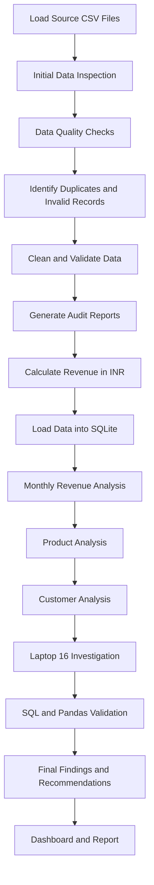

# Data & AI Challenge — Revenue Decline Investigation

## 1. Project overview

This project investigates whether revenue declined from August 2026 to September 2026 and whether the observed change is a genuine business movement or could be affected by data-quality issues.

The analysis uses the supplied orders, customers and products datasets. Python (Pandas) is used for inspection, cleaning, validation and independent calculations. SQLite is used for the SQL analysis.

**Primary reporting measure:** Revenue is calculated as `quantity × unit_price`, converted to INR where required.

**Reporting periods:** 1–28 August 2026 and 1–28 September 2026, based on the valid dates present in the supplied data. The dataset does not contain August 29–31 records. The supplied data ends on September 28, so this analysis must not be described as a comparison of two complete calendar months.

## 2. Project files

| File / folder | Purpose |
|---|---|
| `analysis.ipynb` | Notebook containing the 30 analysis steps and recorded outputs |
| `original/orders.csv` | Original order-level source data |
| `original/customers.csv` | Customer lookup data |
| `original/products.csv` | Product lookup data |
| `output/clean_orders.csv` | Eligible completed records used for trusted revenue analysis |
| `output/rejected_orders.csv` | Deduplicated records excluded from trusted revenue, with reasons |
| `output/duplicate_records.csv` | Exact duplicate copies removed; original occurrence retained |
| `output/data_quality_audit.csv` | Combined record-level audit of excluded records and duplicate copies |
| `queries_template.sql` | Existing supplied SQL template; left unchanged |
| `analysis_queries.sql` | Separate file containing the SQL statements used in the notebook |

The four output CSVs supplied with this documentation are the exported analysis outputs. The original source files and the existing `queries_template.sql` should be retained unchanged.

## 3. Dataset inventory

| Dataset | Rows | Columns | Fields |
|---|---:|---:|---|
| Orders | 244 | 8 | `order_id`, `order_date`, `customer_id`, `product_id`, `quantity`, `unit_price`, `currency`, `status` |
| Customers | 80 | 3 | `customer_id`, `customer_name`, `region` |
| Products | 12 | 3 | `product_id`, `product_name`, `category` |

The orders table is the transaction-level fact dataset. Customer and product tables are lookup tables used to validate keys and enrich product-level reporting.

## 4. Business rules applied

1. Only records with a normalized status of `completed` are eligible for trusted revenue.
2. Cancelled and refunded records are excluded; refund amounts are not subtracted from revenue.
3. Revenue is `quantity × unit_price`.
4. INR is the reporting currency. USD is converted at exactly ₹85 per USD.
5. EUR is unsupported by the supplied challenge rules and is excluded.
6. Status text is trimmed and converted to lowercase. `Completed` with surrounding whitespace is therefore normalized to `completed`.
7. `COMPLETE` is not treated as `completed`; it remains an unsupported status and is excluded.
8. Dates are parsed with mixed-format parsing. Unparseable dates are excluded.
9. Missing or unmatched customer/product keys are excluded; identifiers are not imputed.
10. Non-positive quantity and non-positive unit price are excluded.
11. Exact duplicate rows are deduplicated, retaining the first occurrence.
12. If an order ID has conflicting records, all records for that order ID are excluded.
13. New-versus-repeat classification is based only on the first valid completed order observed in the available August–September dataset. It does not represent the customer's full CRM lifetime history.

## 5. Workflow, phases and observations

## 5. Workflow, Phases and Observations

The following diagram illustrates the complete project workflow, from environment setup and data inspection to final analysis and reporting.

### Phase 1 — Environment setup and source ingestion (Steps 1–2)

**Step 1 — Import libraries**

Imported Pandas, NumPy, Matplotlib, Seaborn and `os`. Display options were configured for notebook inspection.

**Observation:** Libraries imported successfully.

**Step 2 — Load source datasets and preserve originals**

Loaded the three CSVs into `orders`, `customers` and `products`. Deep copies were retained as `orders_original`, `customers_original` and `products_original` so that the source data remained available for comparison and audit.

**Observation:** All three datasets loaded successfully.

### Phase 2 — Initial data understanding and profiling (Steps 3–9)

**Step 3 — Inspect dimensions, columns and data types**

- Orders: 244 rows × 8 columns.
- Customers: 80 rows × 3 columns.
- Products: 12 rows × 3 columns.
- Orders contained 2 integer fields (`quantity`, `unit_price`) and 6 object fields.
- Both lookup tables contained 3 object fields each.

**Step 4 — Review first and last five records**

Displayed the first five and last five records of each dataset to inspect the record structure and sample values.

**Observation:** The orders table contains order-level transaction fields; customer and product tables contain descriptive lookup fields.

**Step 5 — Generate statistical summaries**

Used `describe(include='all')` for all three datasets.

Key observations:
- Orders had 244 records and 240 distinct order IDs.
- Quantity ranged from -1 to 3; its minimum exposed a non-positive quantity.
- Unit price ranged from 0 to 72,000; its minimum exposed a zero price.
- Orders had 3 currency values and 5 raw status values.
- Customer IDs in the lookup table were unique (80).
- Product IDs and product names were unique (12 each); there were 7 product categories.

**Step 6 — Inspect missing values**

- Orders: 2 missing values, both in `customer_id` (0.82% of order rows).
- Customers: no missing values.
- Products: no missing values.

**Step 7 — Inspect exact duplicates and repeated order IDs**

- Orders contained 3 exact duplicate rows.
- 8 order rows belonged to repeated order IDs: `O0008`, `O0030`, `O0081` and `O0089`.
- Customer and product lookup tables contained no exact duplicate rows.
- `O0008`, `O0030` and `O0081` were exact duplicate pairs.
- `O0089` had conflicting unit prices (₹4,400 and ₹2,200) and was not a safe deduplication case.

**Step 8 — Inspect unique values and categorical distributions**

Notable distributions:
- Raw status: `completed` 211, `refunded` 16, `cancelled` 15, ` Completed ` 1, `COMPLETE` 1.
- Currency: INR 242, USD 1, EUR 1.
- Orders had 58 distinct raw date strings, including two slash-separated dates and two invalid date strings.
- Orders referenced 14 distinct product IDs, including unmatched `P998` and `P999`.
- Orders referenced 79 non-null customer IDs, including unmatched `C998` and `C999`.

**Step 9 — Create the initial data-health summary**

| Dataset | Rows | Columns | Missing values | Exact duplicates | Complete rows |
|---|---:|---:|---:|---:|---:|
| Orders | 244 | 8 | 2 | 3 | 99.18% |
| Customers | 80 | 3 | 0 | 0 | 100.00% |
| Products | 12 | 3 | 0 | 0 | 100.00% |

### Phase 3 — Detailed data-quality investigation (Steps 10–14)

**Step 10 — Inspect repeated order IDs**

Reviewed every repeated order ID and its row count.

| Order ID | Records | Observation |
|---|---:|---|
| O0008 | 2 | Exact duplicate pair; cancelled |
| O0030 | 2 | Exact duplicate pair; completed |
| O0081 | 2 | Exact duplicate pair; completed |
| O0089 | 2 | Conflicting unit prices: ₹4,400 and ₹2,200 |

**Step 11 — Investigate missing and unmatched foreign keys**

- Missing customer IDs: 2 records (`O0051`, `O0052`).
- Unmatched customer IDs: 2 records (`C999`, `C998`; orders `O0042`, `O0043`).
- Unmatched product IDs: 2 records (`P998`, `P999`; orders `O0045`, `O0044`).

**Step 12 — Investigate quantity and price validity**

- Non-positive quantities: 2 records (`O0059` quantity 0; `O0053` quantity -1).
- Non-positive unit prices: 1 record (`O0054` unit price 0).

**Step 13 — Investigate date formats**

Used `pd.to_datetime(..., format="mixed", errors="coerce")`.

- Unparseable dates: 2 (`O0037` = `not-a-date`; `O0036` = `2026-09-31`).
- Slash-separated dates such as `2026/08/13` and `2026/08/19` parsed successfully.

**Step 14 — Inspect status and currency values**

- Status values were reviewed before normalization. ` Completed ` becomes `completed` after trimming and lowercasing. `COMPLETE` remains unsupported.
- Currency values were reviewed against the permitted currencies. INR and USD are supported; EUR is not.

### Phase 4 — Cleaning, eligibility, audit and export (Steps 15–21)

**Step 15 — Create a working copy and remove exact duplicate copies**

Created a deep working copy and preserved the original row index as `source_row_index`. Exact duplicates were detected across all original order columns. The first occurrence was retained.

| Measure | Records |
|---|---:|
| Original orders | 244 |
| Exact duplicate copies removed | 3 |
| Records after exact deduplication | 241 |

**Step 16 — Identify conflicting order IDs**

After exact deduplication, `O0089` remained as a repeated ID with conflicting prices. Both records were identified for exclusion.

**Step 17 — Apply record-level validation flags**

Validation flags were created for conflicting IDs, missing/unmatched keys, invalid quantity, invalid price, invalid date, unsupported status and unsupported currency.

| Validation flag | Affected records |
|---|---:|
| Conflicting order ID | 2 |
| Missing customer ID | 2 |
| Unmatched customer ID | 2 |
| Unmatched product ID | 2 |
| Invalid quantity | 2 |
| Invalid price | 1 |
| Invalid date | 2 |
| Unsupported status | 1 |
| Unsupported currency | 1 |

These flag counts can overlap because one record can have more than one issue. They must not be added together to calculate unique rejected records.

**Step 18 — Generate rejection reasons and separate eligible records**

Cancelled and refunded orders were also marked as ineligible for trusted revenue. The deduplicated records were divided into `clean_orders` and `rejected_orders`.

| Measure | Records |
|---|---:|
| Eligible completed records | 197 |
| Rejected / excluded records after deduplication | 44 |

The 44 excluded records include cancelled and refunded transactions as well as records failing data-quality or business-rule checks. They are not all data errors.

**Step 19 — Calculate trusted revenue in INR**

Applied the specified exchange rates:
- INR = 1
- USD = 85

Calculated `revenue_inr = quantity × unit_price × exchange_rate`.

**Recorded total trusted revenue: ₹2,946,400.**

The clean dataset contains 196 INR records and 1 USD record. The EUR record was excluded.

**Step 20 — Generate the cleaning audit report**

Combined the 44 rejected/excluded deduplicated records with the 3 exact duplicate copies into `data_quality_audit.csv`.

- Rejected/excluded records: 44.
- Exact duplicate copies removed: 3.
- Total audit rows: 47.

The duplicate decision is recorded as `Removed duplicate copy; original retained`. Excluded records are recorded as `Excluded from trusted revenue`.

**Step 21 — Export processed datasets**

Exported:
- `clean_orders.csv`
- `rejected_orders.csv`
- `duplicate_records.csv`
- `data_quality_audit.csv`

The supplied final CSVs contain 197, 44, 3 and 47 rows respectively.

### Phase 5 — SQL analysis and independent validation (Steps 22–30)

**Step 22 — Prepare the trusted dataset for SQL**

Created `order_date_clean` in `YYYY-MM-DD` format, opened an in-memory SQLite connection and loaded the trusted records as `clean_orders`. The `products` lookup table was also loaded into SQLite before product queries were run.

**Step 23 — Calculate monthly revenue using SQL**

| Metric | August 2026 | September 2026 |
|---|---:|---:|
| First transaction date | 2026-08-01 | 2026-09-01 |
| Last transaction date | 2026-08-28 | 2026-09-28 |
| Active sales days | 28 | 26 |
| Transactions | 113 | 84 |
| Units sold | 135 | 110 |
| Revenue | ₹1,809,000 | ₹1,137,400 |
| Average transaction revenue | ₹16,008.85 | ₹13,540.48 |

September revenue change: **-₹671,600 (-37.13%)** compared with August.

**Step 24 — Independently calculate monthly results using Pandas**

Pandas independently calculated monthly transaction count, units, revenue, average transaction revenue and first/last transaction dates.

Recorded revenue:
- August: ₹1,809,000.
- September: ₹1,137,400.

**Step 25 — Reconcile SQL and Pandas revenue**

| Month | SQL revenue | Pandas revenue | Difference |
|---|---:|---:|---:|
| August 2026 | ₹1,809,000 | ₹1,809,000 | ₹0 |
| September 2026 | ₹1,137,400 | ₹1,137,400 | ₹0 |

The notebook output records a successful reconciliation. **Note:** The uploaded notebook contains the reconciliation calculation/output but does not contain the preceding code that creates the merged `comparison` DataFrame. That missing merge step has not been invented or inserted into the SQL file.

**Step 26 — Identify the top 10 products by revenue**

| Product | Category | Units | Orders | Revenue | Revenue contribution |
|---|---|---:|---:|---:|---:|
| Laptop 16 | Computers | 15 | 11 | ₹1,080,000 | 36.65% |
| Laptop 14 | Computers | 13 | 10 | ₹650,000 | 22.06% |
| HDD 4TB | Storage | 29 | 25 | ₹237,800 | 8.07% |
| Printer | Printers | 15 | 11 | ₹225,000 | 7.64% |
| USB-C Dock | Accessories | 27 | 21 | ₹202,500 | 6.87% |
| 24in Monitor | Displays | 14 | 11 | ₹182,000 | 6.18% |
| SSD 1TB | Storage | 21 | 18 | ₹136,500 | 4.63% |
| Router | Networking | 17 | 13 | ₹80,500 | 2.73% |
| Headset | Audio | 29 | 23 | ₹63,800 | 2.17% |
| Keyboard | Accessories | 22 | 19 | ₹35,200 | 1.19% |

The two laptop products contribute 58.71% of total trusted revenue. The top 10 products contribute approximately 98.19%.

**Step 27 — Compare product revenue between August and September**

| Product | August revenue | September revenue | Change |
|---|---:|---:|---:|
| Laptop 16 | ₹936,000 | ₹144,000 | -₹792,000 |
| 24in Monitor | ₹130,000 | ₹52,000 | -₹78,000 |
| Router | ₹67,000 | ₹13,500 | -₹53,500 |
| HDD 4TB | ₹139,400 | ₹98,400 | -₹41,000 |
| SSD 1TB | ₹78,000 | ₹58,500 | -₹19,500 |
| Wireless Mouse | ₹17,100 | ₹13,500 | -₹3,600 |
| Keyboard | ₹17,600 | ₹17,600 | ₹0 |
| Webcam | ₹10,000 | ₹12,500 | +₹2,500 |
| USB-C Dock | ₹97,500 | ₹105,000 | +₹7,500 |
| Headset | ₹26,400 | ₹37,400 | +₹11,000 |
| Printer | ₹90,000 | ₹135,000 | +₹45,000 |
| Laptop 14 | ₹200,000 | ₹450,000 | +₹250,000 |

Laptop 16 had the largest negative product-level change (-₹792,000). Growth in other products partially offset this decline. Laptop 16's reduction is larger than the net overall revenue decline because some other products grew.

**Step 28 — Analyze new versus repeat customers**

Classification uses the first eligible completed order observed for each customer in the available August–September dataset. The first observed order is labelled `New`; subsequent observed orders are labelled `Repeat`.

| Month | Customer type | Customers in segment | Orders | Revenue | Average order revenue |
|---|---|---:|---:|---:|---:|
| August | New | 64 | 64 | ₹580,400 | ₹9,068.75 |
| August | Repeat | 37 | 49 | ₹1,228,600 | ₹25,073.47 |
| September | New | 10 | 10 | ₹161,600 | ₹16,160.00 |
| September | Repeat | 44 | 74 | ₹975,800 | ₹13,186.49 |

Observed changes:
- First-observed new-customer count decreased from 64 to 10.
- New-customer revenue decreased by ₹418,800.
- Repeat-customer count in the repeat-order segment increased from 37 to 44.
- Repeat-customer revenue decreased by ₹252,800.

The customer counts are segment counts based on orders. A customer can be represented in both segments within a month if they placed their first observed order and a subsequent order in that same month. These counts should not be added and presented as a mutually exclusive total customer count.

**Step 29 — Investigate Laptop 16 revenue decline**

| Metric | August | September |
|---|---:|---:|
| Orders | 9 | 2 |
| Units sold | 13 | 2 |
| Revenue | ₹936,000 | ₹144,000 |
| Average unit price | ₹72,000 | ₹72,000 |

Laptop 16 units sold decreased from 13 to 2, while the average unit price remained ₹72,000. The observed decline is therefore volume-related in this dataset; the query does not establish the underlying cause of the lower sales volume.

**Step 30 — Validate monthly data coverage**

| Month | First order date | Last order date | Active sales days | Orders |
|---|---|---|---:|---:|
| August 2026 | 2026-08-01 | 2026-08-28 | 28 | 113 |
| September 2026 | 2026-09-01 | 2026-09-28 | 26 | 84 |

There are no August 29, 30 or 31 order records in the supplied source data. The latest valid September date is September 28. The comparison therefore uses the common observed window of days 1–28; it is not a full-calendar-month comparison.

## 6. Consolidated business findings

### Finding 1 — Revenue declined in the observed comparison window

Trusted completed revenue decreased from ₹1,809,000 in August to ₹1,137,400 in September, a reduction of ₹671,600 or 37.13%.

### Finding 2 — Laptop 16 was the largest negative product contributor

Laptop 16 revenue decreased by ₹792,000, from ₹936,000 to ₹144,000. Units sold decreased from 13 to 2, while average unit price remained ₹72,000.

### Finding 3 — New-customer activity was lower in September

The count of customers whose first eligible order was observed in the available dataset during September was 10, compared with 64 in August. Repeat-order segment customers increased from 37 to 44, while repeat-segment revenue decreased.

### Finding 4 — Other product growth partly offset Laptop 16's decline

Laptop 14 revenue increased by ₹250,000 and Printer revenue increased by ₹45,000. These increases partly offset the negative changes in other products.

## 7. Data limitations and interpretation cautions

1. The supplied dataset does not include August 29–31 order records or September 29–30 records. The results are based on the common observed window, days 1–28.
2. A date range and active-sales-day count do not prove that every possible transaction was captured.
3. The data does not include inventory/stock availability, website traffic, marketing campaigns, sales pipeline, payment failures, discounts or customer-contact history. It cannot establish why sales volume or new-customer activity changed.
4. New/repeat status is based only on the first valid completed order in the available two-month dataset, not lifetime customer history.
5. EUR was excluded because no conversion rule was provided. USD was converted at ₹85 as specified.
6. Cancelled and refunded transactions were excluded from eligible revenue. Refund amounts were not subtracted.
7. The data-quality validation flag counts overlap; they are not additive unique-record counts.
8. The average transaction revenue is the average of the row-level `revenue_inr` values in the trusted dataset.
9. The product revenue contribution percentages use total trusted revenue across the two observed months as the denominator.
10. The analysis identifies observed associations and contributors; it does not prove causal explanations.

## 8. Recommended business follow-up

- Investigate Laptop 16 sales volume in September: check stock availability, sales activity, lead conversion and demand data before assigning a cause.
- Review the new-customer acquisition funnel and September campaign/lead activity.
- Review repeat-customer revenue and order-value patterns, not just repeat-customer counts.
- Introduce automated checks for duplicate/conflicting order IDs, missing or unmatched keys, invalid dates, non-positive quantities/prices, unsupported statuses and currencies.
- Confirm that future reporting extracts include complete month-end transaction data.

## 9. Reproducibility notes

1. Keep the original CSVs unchanged.
2. Run the notebook in order from Step 1 to Step 30.
3. The notebook expects the source files under `original/`.
4. The export step writes the four processed CSVs under `output/`.
5. The SQL queries are provided separately in `analysis_queries.sql`. They are copied from the SQL strings in the notebook; the supplied `queries_template.sql` is not modified.
6. The SQLite database is created in memory during notebook execution. Re-run the notebook to recreate its tables.
7. The `products` table must be loaded into the same SQLite connection before running the product queries.

## 10. Final Visualization

### Revenue Decline Dashboard

### Daily Revenue Trend

### August Vs September Preformance

### New Vs Repeat Customers

### Product-wise Monthly Comparison

### Product-wise Revenue  Contribution

